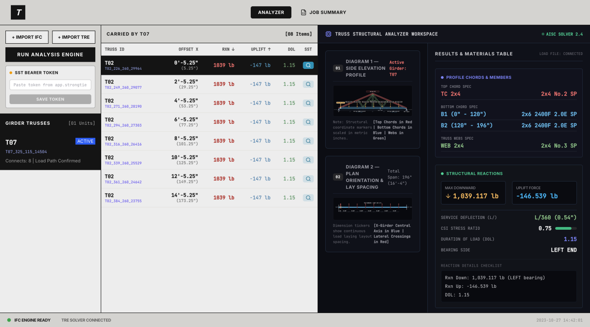
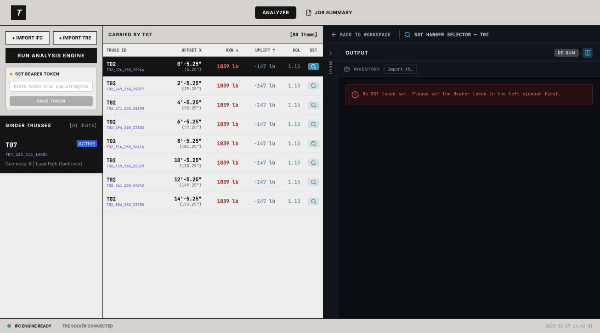
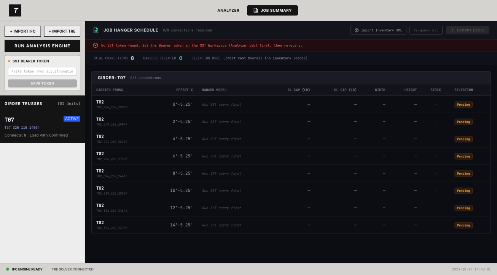

# Truss Analyzer — UI baseline

**Status:** Recorded 2026-11-23 at commit `357706a`. This is a snapshot of the app before the UI rework; do not edit it to match later changes.  
**Companion:** [UI rework specification](../hy4/ui-rework-spec.md), [Technical specification](../hy4/technical-spec.md).  
**Method:** read all of `src/`, the seven specs in `docs/hy4/`, ran install, type-check, build and dependency audit, ran the app locally with the bundled sample, and ran the parser on the sample, `Test3/` and `Test4/`.

## 1. Verdict

The analysis engine is in usable shape and gives stable results on all three fixture sets. The UI is a prototype: three files hold almost all of it, there is no shared visual system, most text is too small to read, nothing is exposed to assistive technology, and several on-screen status labels are hard-coded and not derived from data. The [UI rework specification](../hy4/ui-rework-spec.md) describes the right fixes; this baseline confirms its claims against the code and adds the numbers to measure the rework against.

## 2. What the app is

- Single-page React 19 + TypeScript app, Vite 6, Tailwind 4. No backend, no router, no state library, no tests.
- Reads IFC and MiTek TRE files in the browser, finds girder trusses and the trusses they carry, draws two diagrams, asks the Simpson Strong-Tie (SST) hanger API for candidates, and exports an Excel hanger schedule.
- Deployed on Railway with `vite preview` as the server.

## 3. Structure

| Path | Lines | Role | State |
| --- | --- | --- | --- |
| `src/App.tsx` | 184 | Shell, tabs, all shared state, loads sample on start | Active |
| `src/components/FileUpload.tsx` | 220 | File pickers, run button, SST token box | Active |
| `src/components/GirderList.tsx` | 59 | Girder list in sidebar | Active |
| `src/components/GirderDetails.tsx` | 1130 | Carried table, properties panel, both SVG diagrams | Active |
| `src/components/SSTWorkspace.tsx` | 1350 | Hanger selector: inputs, mapping view, results, inventory | Active |
| `src/components/JobSummaryTable.tsx` | 735 | Summary, batch lookup loop, ranking, Excel export | Active |
| `src/components/HangerPanel.tsx` | 774 | Older hanger panel | Dead, never imported |
| `src/components/ExportTab.tsx` | 173 | JSON export view | Dead, never imported |
| `src/components/LogPanel.tsx` | 49 | Log viewer | Imported in `App.tsx`, never rendered |
| `src/data.ts` | 4 | Empty mock dataset | Dead |
| `src/lib/parser.ts` | 1553 | IFC/TRE parsing and connection inference | Active, no UI code |
| `src/lib/sst-mapper.ts`, `sst-api.ts`, `sst-types.ts`, `inventory.ts` | 945 | SST payload, client, inventory XML | Active, no UI code |

Findings:

- **About 1000 lines are dead** (`HangerPanel`, `ExportTab`, `data.ts`) and `LogPanel` is wired but hidden, so parser logs are collected and never shown.
- **UI and logic are mixed.** `JobSummaryTable` owns the batch request loop, hanger ranking and workbook generation. `SSTWorkspace` sends requests from a `useEffect`. These need to move out before the screens can be restyled safely.
- **No reusable UI parts.** No Button, Table, Badge, Panel or Field component. Every element is styled inline with long Tailwind class strings.
- **The lib layer is clean of UI** and can stay untouched, as the spec requires.

## 4. Build and health

| Check | Result |
| --- | --- |
| `npm ci` | Passes |
| `npm run lint` (type-check) | **Fails, 4 errors**: three `?raw` imports have no type declaration (no `vite/client` types), and `preview.allowedHosts: true` is typed wrongly in `vite.config.ts` |
| `npm run build` | Passes |
| Bundle | **4.47 MB JS (824 KB gzipped)** in one file; the three bundled sample files (about 3.8 MB of text) are compiled into it |
| `npm audit` | 8 advisories (6 high). `xlsx` 0.18.5 has two with **no fix on npm**; Vite ones are fixed by a patch update |
| Tests | None. No test script, no CI, no linter beyond `tsc` |
| Unused dependency | `motion` is installed and never imported |
| Fonts | Inter and JetBrains Mono are loaded from Google Fonts by a CSS `@import`, which delays first paint and needs network |

The spec's acceptance check "`npm run lint` and `npm run build` pass" is not true today, so lint must be fixed first or the rework has no clean starting point.

## 5. Parser baseline (for regression during the rework)

Full data: [`parser-baseline.json`](parser-baseline.json) (girder labels, ordered connections, offsets, spacing, reactions, bearing side, duration factors).

| Fixture | Girders | Connections | Warnings / errors |
| --- | --- | --- | --- |
| Bundled sample | 1 (T07) | 8 | 0 |
| `Test3/` | 8 | 58 | 0 |
| `Test4/` | 6 | 48 | 0 |

Each set parses in under one second on a laptop.

- Every connection has a positive downward reaction in all three sets.
- **`Test3/` returns three girders all labelled `J06C`** (3 connections each). The girder list shows the label large and the unique ID in 9 px text, so they look identical. The rework needs a way to tell repeated labels apart.

## 6. UI baseline, measured on the running app

Screens captured at 1306 × 726 with the bundled sample and no SST token:

| Analyzer | Hanger selector | Job Summary |
| --- | --- | --- |
|  |  |  |

### 6.1 Readability

- On the Analyzer screen, **159 of 177 text elements render below 12 px**. Sizes in use: 7.5, 8, 8.5, 9, 10, 11 px.
- In the source, 221 of about 240 font-size classes are 11 px or smaller; 98 are 9 px and 55 are 8 px.
- **Diagram labels render about 2 to 2.5 px tall.** The two SVG diagrams sit in a 190 px wide column, so member names, offsets and dimensions cannot be read at all.
- Almost all labels are uppercase with wide letter spacing.

### 6.2 Visual system

- **40 distinct hex colours** hard-coded in components, plus 10 Tailwind colour families (zinc used 259 times, then emerald, amber, cyan, red, sky, indigo, green, rose, blue).
- Two unrelated themes on one screen: a warm grey light theme (`#E4E3E0`, `#141414`) for shell, sidebar and carried table, and a dark navy theme (`#1E293B`, `#12131C`, `#0C0D14`) for the workspace, hanger selector and summary.
- No design tokens. `src/index.css` defines only two font families, a grid pattern and a scrollbar.

### 6.3 Layout

- Fixed columns: sidebar 224 px, carried table 480 px, properties 360/380 px. The diagrams get what is left.
- Only two responsive classes in the whole codebase. The shell is `h-screen overflow-hidden`, so small windows clip content instead of scrolling.
- The header has a logo tile and no app name, job name or settings.
- The sidebar spends its top third on import buttons and the SST token box.

### 6.4 Accessibility

- **Zero `aria-*` and zero `role` attributes** in the codebase.
- 76 elements on the Analyzer screen are clickable `div`/`tr` elements, not buttons, so girders and carried rows cannot be selected by keyboard.
- No `h1`, no `nav`; table headers have no `scope`.
- `select-none` is set on the whole app, so **users cannot select or copy any value**, including loads and IDs.
- Inputs remove the focus outline (`outline-none` in 13 places); buttons keep the browser default.
- The "Find hangers" icon button has a tooltip title only.
- Reaction direction and stock status are shown by colour and arrows.

### 6.5 Labels that are not real data

These appear authoritative but are constants or guesses in the code. In an engineering tool this is the highest-risk UI problem.

| On screen | Where | Reality |
| --- | --- | --- |
| "IFC Engine Ready", "TRE Solver Connected" | Footer, `App.tsx` | Static text |
| "2023-10-27 14:42:01" | Footer | Static text |
| "AISC solver 2.4" | `GirderDetails.tsx:199` | Static text; there is no solver |
| "Load File: Connected" | `GirderDetails.tsx:288` | Static text |
| "Load Path Confirmed", "PRIMARY" | `GirderList.tsx` | Static text |
| "Connection State: NOMINAL … verified compliant under wood design code requirements" | `GirderDetails.tsx:486-490` | Static text; nothing is verified |
| "Service Deflection L/360 (0.54\")" | `GirderDetails.tsx:75` | Computed as span ÷ 360, not read from the files |
| CSI stress ratio | `GirderDetails.tsx:76` | Falls back to 0.76 when the file has none |
| Chord and web materials | `GirderDetails.tsx:55-57` | Fall back to fixed strings such as "2x4 No.2 SP" |
| Span and bottom-chord split | `GirderDetails.tsx:47,54` | Special-cased for label `T07` (196 in, split at 120 in); other girders split at 61% of span |
| SST token "Connected" | `FileUpload.tsx` | Means only that a token is saved |

### 6.6 Behaviour

- The sample job loads and is analysed on every page load, unlabelled as a sample.
- "Run Analysis Engine" with no files runs a third, inline mock job.
- File buttons show counts, never filenames. Pickers accept only `.ifc` and `.tre`, while the bundled sample files are `.txt`.
- Opening Job Summary starts SST requests automatically when a token is saved. The hanger selector also queries on open and on every input change.
- A failed analysis logs "Critical failure during analysis" to the hidden log and shows nothing.
- The token box tells users to paste a token copied from another site's DevTools, and it is stored in `localStorage`.
- No request is tied to a job, so a late SST answer can land in a newly loaded job (documented in the technical spec; confirmed in `App.tsx`).

## 7. Gaps this baseline found in the rework spec

These were missing or not explicit in the UI rework specification when the baseline was taken, and were added to it in the same change:

1. `npm run lint` already fails, so the rework has no clean starting point.
2. Repeated girder labels (`J06C` × 3 in `Test3/`).
3. The full list of labels that are not real data (6.5).
4. `select-none` blocking copy of values.
5. Dead code (`HangerPanel`, `ExportTab`, `data.ts`) and the unused `motion` package.
6. The 4.47 MB bundle caused by compiling the sample files in.

Recorded here but outside the UI rework: the `xlsx` advisories with no npm fix, and `vite preview` as the production server.

## 8. Not checked

- Any live SST request: no token was used, so the results table, filters, inventory import and a filled Excel export were read in code only.
- Widths other than 1306 px, zoom levels, a screen reader, and colour contrast ratios.
- The Railway deployment.
- Whether the parser's numbers are correct engineering values; only that they are stable.
